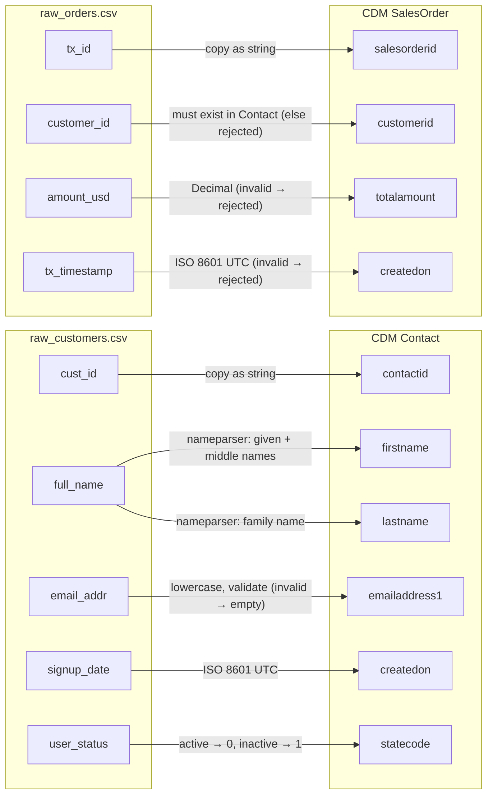
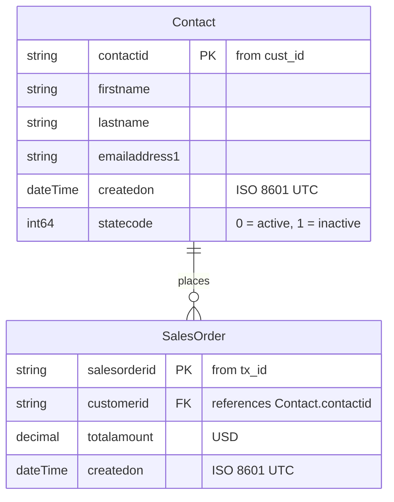
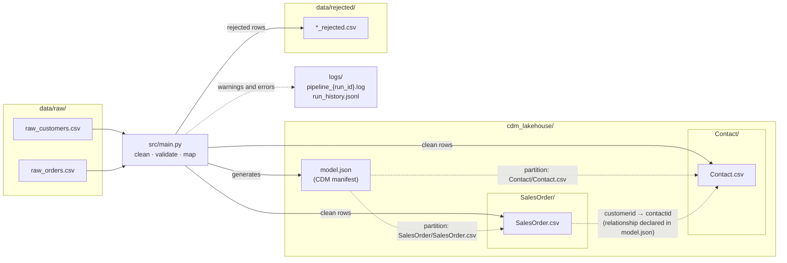

# CDM Ingestion Pipeline

Python ETL pipeline that ingests raw customer and order data from CSV, validates and transforms it
into the Microsoft Common Data Model (CDM) entities `Contact` and `SalesOrder`, and writes the
result to a lakehouse folder with a CDM `model.json` manifest.

## Setup and execution

Requirements: Python 3.11 or newer (tested with 3.14). Dependencies are listed in `requirements.txt`.

```powershell
py -m venv .venv
.venv\Scripts\python.exe -m pip install -r requirements.txt
.venv\Scripts\python.exe src\main.py
.venv\Scripts\python.exe -m pytest
```

On macOS/Linux, use `python3 -m venv .venv` and `.venv/bin/python`.

The flag `--core-only` restricts the run to the scope of the assignment (see [Extras](#extras)).

Outputs:

| Path | Content |
|---|---|
| `cdm_lakehouse/Contact/Contact.csv` | Contact entity |
| `cdm_lakehouse/SalesOrder/SalesOrder.csv` | SalesOrder entity |
| `cdm_lakehouse/model.json` | CDM manifest |
| `data/rejected/<source>_rejected.csv` | Rejected records with line number and reason |
| `logs/` | Run log and run history |

Result on the mock data: 5 contacts and 4 orders loaded; 1 order rejected (ORD-1005, references
the non-existent customer CST-999).

## Project structure

```
src/
  main.py                 entry point, orchestration
  transform_contacts.py   raw_customers -> Contact
  transform_orders.py     raw_orders -> SalesOrder
  manifest.py             model.json generation
  utils.py                CSV parsing, primary key checks, timestamp and email validation
  extras.py               plausibility checks, reconciliation, run history
tests/                    pytest suite
data/raw/                 source files
data/rejected/            rejected records
cdm_lakehouse/            target data and manifest
```

## Diagrams

### Source-to-target mapping



### Entity relationship

Cardinality Contact : SalesOrder = 1 : N.



### Storage layout



## Data quality rules

Issues that can be resolved deterministically, without inferring missing information, are
corrected and logged as warnings. Invalid values in non-essential attributes (email, status,
contact `createdon`) are set to null and the record is loaded. Records with an invalid key or an
invalid essential attribute (order amount, order timestamp) are excluded from the target and
written to `data/rejected/` for manual review.

Corrected (logged as warning):

- Leading/trailing whitespace; casing of email addresses and status values.
- Records split by a line break (CST-005): two consecutive lines with too few fields are merged
  if the result has exactly the expected number of fields.
- Timestamps without timezone are interpreted as UTC, consistent with all other timestamps in the
  sources (suffix `Z`). Date-only values are set to `00:00:00`. The source timezone is configured
  in `utils.SOURCE_TIMEZONE`.
- Invalid email addresses, unknown status values and unparseable contact signup dates are set
  to null. Rejecting the contact instead would also reject all of its orders as orphans.
- Exact duplicate records are deduplicated.

Rejected:

- Orphan orders (`customer_id` not present in Contact), to preserve referential integrity of the
  relationship declared in `model.json`.
- Empty primary keys; conflicting duplicates (same key, different attributes).
- Orders with an invalid amount or timestamp.
- Malformed lines that cannot be repaired.

Further rules:

- Name splitting uses `nameparser`: `firstname` = given + middle names, `lastname` = family name
  including particles ("Ludwig van Beethoven" → Ludwig / van Beethoven). Titles and suffixes are
  dropped. Single-token names are mapped to `lastname`, the mandatory attribute in CDM.
- Amounts are parsed as `Decimal` to avoid floating-point rounding.
- A header mismatch against the expected source schema aborts the run.

## Extras

The following features exceed the scope of the assignment. They are implemented in
`src/extras.py`, enabled by default and disabled with `--core-only`. They do not affect which
records are loaded.

- **Plausibility checks:** warnings for valid but suspicious values. These cover future dates, an
  order date before the customer's signup date, negative amounts, and amounts above 10,000 USD
  (example threshold).
- **Reconciliation:** per source file, verifies that
  `raw records = loaded + rejected + merged + deduplicated`. Raw records are counted independently
  of the transformation logic. On mismatch, the run aborts before any output is written.
- **Run history and lineage:** each run is assigned a run ID. `logs/run_history.jsonl` stores one
  entry per run, with the status, the record counts and the SHA-256 checksum of each input file.
  `model.json` is extended with the standard fields `modifiedTime`, `refreshTime` and a run ID
  annotation.

With `--core-only`, `model.json` is identical to the reference structure in the assignment.

## Limitations

- Ambiguous multi-part names (e.g. "María José García López") cannot be split reliably without
  separate name fields in the source.
- Orphan orders are rejected. With late-arriving customer data, loading and flagging them would
  be the more suitable strategy.
- Rejected files contain only the records of the latest run.
- Files are processed in memory; large volumes would require chunked processing or a distributed
  engine such as Spark.
